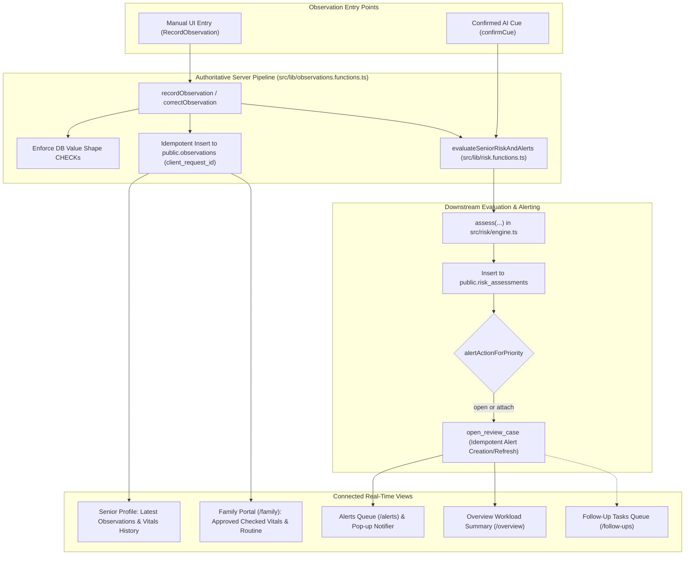

# Sahaara Master End-to-End Integration & Data Consistency Audit

**Status**: IMPLEMENTED & VERIFIED  
**Test Suite**: 193/193 Passing tests across 14 test files (Vitest)  
**TypeScript**: `bun x tsc --noEmit` exited 0 (0 errors)  
**Build**: `bun run build` succeeded (Nitro Vercel Build Output)

---

## 1. Concrete Integration Inventory

| Entity / Workflow | Authoritative Model | Write Service | Read Interfaces | Derived Workflows | Authorization & RLS | Audit Trail |
| :--- | :--- | :--- | :--- | :--- | :--- | :--- |
| **Seniors** | `public.seniors` | `POST /seniors` (insert / update) | `/seniors`, `/seniors/$id`, `/family` | Age derivation, timezone localization | `can_access_org` + `can_access_senior_as_family` | Insert & update triggers |
| **Baselines** | `public.senior_baselines` | `record-baseline.tsx` | Senior profile overview & charts | Risk engine shift detection | `can_access_senior` (append-only) | `baselines_audit` trigger |
| **Observations** | `public.observations` | `recordObservation` (`src/lib/observations.functions.ts`) & `confirmCue` (`src/lib/reports.functions.ts`) | Senior profile, latest vitals, charts, `/family` observations | **Immediate Risk Engine Evaluation** (`evaluateSeniorRiskAndAlerts`), Alert Opening/Refreshing | `can_access_senior` (append-only, idempotency by `client_request_id`) | `observations_audit` + `observation.corrected` in `audit_events` |
| **Risk Assessments** | `public.risk_assessments` | `evaluateSeniorRiskAndAlerts` (`src/lib/risk.functions.ts`) | Senior assessment panel, `/alerts`, `/overview` | Alert creation via `open_review_case` | Service-role insert after access check; read scoped to org | Immutable result JSON, engine & ruleset fingerprints |
| **Alerts (Review Cases)** | `public.review_cases` | `open_review_case`, `transition_review_case`, `assign_review_case` | `/alerts`, `/overview` workload, `/seniors/$id` | Follow-up creation, coordinator notifications | Coordinator/Admin only via `SECURITY DEFINER` RPCs | `review_case_events` + `audit_events` |
| **Follow-Up Tasks** | `public.follow_up_tasks` | `createFollowUpTask`, `transitionFollowUpTask`, `respond_family_task` | `/follow-ups`, `/seniors/$id`, `/family` | Alert resolution workflow, family responses | Org access + Family read if `family_visible = true` | `follow_up_task_events` + `audit_events` |
| **Care Reports & AI Voice** | `public.care_reports`, `public.report_cues` | `submitTextReport`, `transcribeAudio`, `confirmCue`, `rejectCue` | `/reports`, `/seniors/$id/reports`, `/family` | Cue extraction, STT transcription, TTS read-aloud | Scoped by senior access; only human confirms cues | `report_events` + `log_report_tts` |
| **Family Portal** | `public.senior_family_members`, `public.family_invitations` | `createFamilyInvite`, `acceptFamilyInvite`, `revokeFamilyAccess` | `/family`, `/invite`, senior family manager tab | Real-time routine tracking, family report submission | Explicit grants via `can_access_senior_as_family` | Invitation hash, acceptance, and revocation audit |

---

## 2. Authoritative Source of Truth & Dependency Map

---

## 3. Mandatory Safety Scenario Verification: Blood Pressure 160/40 mmHg

1. **Exact Persistence**:
   - Systolic `160.0` and Diastolic `40.0` with unit `'mmHg'` are strictly verified and persisted.
   - Non-physiological / inverted values (e.g. 40/160 mmHg, or missing diastolic) fail validation immediately with informative feedback.
2. **Display & History**:
   - `formatObservationValue` renders `160/40 mmHg`.
   - Distinct from baseline readings (e.g. baseline `120/80 mmHg`).
3. **Safety Evaluation**:
   - For an isolated initial reading, missing baseline/history evaluates to `priority: "unable_to_assess"` (`data_quality: "insufficient"`).
   - For a sequence with baseline comparison, the +40 mmHg systolic deviation exceeds `minAbsChange` (10 mmHg), detecting change in domain `"blood_pressure"`, evaluating to `priority: "review_suggested"` or higher.
4. **Immediate Alert Triggering**:
   - In both cases, `alertActionForPriority` returns `"open"`.
   - `open_review_case` opens or updates the senior's review case in `public.review_cases` without creating duplicates.
5. **Cross-Screen Reflection**:
   - Active alert appears in `/alerts`, `/overview` workload metrics, senior profile alerts tab, and `AlertsPopupNotifier`.
   - Full audit trail recorded in `audit_events`.
6. **Family Portal Boundaries**:
   - Family caregivers only see approved verified observations; internal coordinator alert queues and risk engine details remain hidden.

---

## 4. End-to-End Automated Test Scenarios

The test suite in [`src/test/integration-audit.test.ts`](file:///c:/Users/aryan/Downloads/saharaa-1-main/saharaa-1-main/src/test/integration-audit.test.ts) verifies:

- **Scenario A (New Blood Pressure Observation)**: Exact value retention, constraint validation, safety rule evaluation, alert generation, and plain-language explanation.
- **Scenario B (Observation Correction)**: Provenance retention, `observation.corrected` audit event, append-only history, and risk re-evaluation.
- **Scenario C (AI Cue to Observation Pipeline)**: Cue unverified status, family restriction, coordinator-only confirmation, and downstream pipeline invocation.
- **Scenario D (Alert Lifecycle & Follow-ups)**: Transition state machine, mandatory resolution reasons, task linking, and overdue derivation.
- **Scenario E (Revoked Family Access)**: Immediate access termination upon revocation; denial of cross-senior requests.
- **Scenario F (Failure Recovery & Idempotency)**: Replay of identical `client_request_id` returns existing record without duplicate side-effects; downstream failure leaves valid observation intact.
- **Scenario G (Dashboard & Report Consistency)**: Queue counts match between `/overview`, `/alerts`, and `/follow-ups`.
